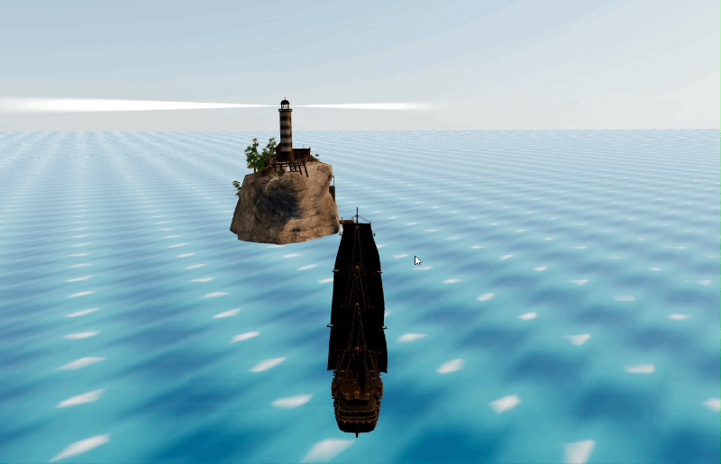

# ⛵ Portafolio interactivo 3D

[](https://react.dev/)
[](https://vitejs.dev/)
[](https://threejs.org/)
[]()

Portafolio web personal desarrollado con React y Three.js. El visitante navega por un océano en un barco y, al acercarse a islas específicas, puede abrir un panel con información que aporta al portafolio personal del autor.

<p align="center">
  
  <br>
  <em>Vista previa: navegando el barco hasta la isla</em>
</p>

<p align="center">
  <a href="https://cm-portfolio-web3d.vercel.app">
    
  </a>
</p>

---

## 📑 Tabla de Contenidos

- [Funcionalidades](#-funcionalidades)
- [Tecnologías](#-tecnologías)
- [Requisitos](#-requisitos)
- [Instalación y ejecución local](#-instalación-y-ejecución-local)
- [Controles](#-controles)
- [Comandos](#-comandos)
- [Estructura del proyecto](#-estructura-del-proyecto--sprint-1)
- [Estado del Proyecto](#-estado-del-proyecto)
- [Créditos y Licencias](#-créditos-y-licencias)
- [Autor](#-autor)

---

## ✨ Funcionalidades

- Escena 3D con océano animado e islas.
- Navegación del barco con teclado y reducción gradual de velocidad cerca de las islas.
- Título 3D y botón de interacción cuando el barco entra en el radio de las islas.
- Panel con información del perfil y los proyectos.
- Colisiones físicas con Rapier: el barco no atraviesa las islas ni sale del mapa, y un aviso HTML aparece al acercarse al borde del mundo.
- Vaivén del barco con el oleaje, calculado con las mismas funciones de ola del océano.
- Panel de configuración inicial con interruptor de audio e instrucciones de control.
- Isla de redes y hoja de vida: carteles 3D clicables (GitHub, Hoja de vida, Facebook) y panel con estudios y gustos. Un enlace sin configurar se muestra como "Próximamente".
- Cursor personalizado de estrella náutica sobre el lienzo 3D.
- Pantalla de carga con progreso y botón para iniciar la experiencia.
- Cámara libre de depuración, disponible en desarrollo con el parámetro `?debug`.

## 🛠️ Tecnologías

- **React 19** y **Vite** — Entorno de desarrollo rápido.
- **Three.js**, **React Three Fiber** y **Drei** — Renderizado de la escena 3D.
- **Zustand** — Gestión del estado global de navegación e interacción.
- **@react-three/rapier** — Físicas y colisiones del barco, las islas y los límites del mundo.

## 📋 Requisitos

- Node.js `20.19` o superior.
- npm.

## 🚀 Instalación y ejecución local

1. Clona el repositorio:

```bash
git clone https://github.com/AndresMZMZ/cm-portfolio-web3d.git
cd cm-portfolio-web3d
```

2. Instala las dependencias y ejecuta el servidor de desarrollo:

```bash
npm ci
npm run dev
```

3. Abre en el navegador la dirección que indique Vite; normalmente es `http://localhost:5173/`.

## 🎮 Controles

| Teclas                     | Acción                                                          |
| -------------------------- | --------------------------------------------------------------- |
| Flecha arriba / abajo      | Avanzar / retroceder con el barco                               |
| Flecha izquierda / derecha | Girar el barco                                                  |
| Enter o F                  | Abrir el panel cuando el barco está cerca de una isla           |
| Q / E                      | Seleccionar los cañones de babor (izquierda) o estribor (derecha) |
| R                          | Seleccionar los cañones de popa                               |
| W / S                      | Ajustar elevación y alcance estimado de los cañones              |
| A / D                      | Girar la mira de los cañones                                    |
| Arrastrar botón derecho    | Ajustar la mira y el alcance con el movimiento vertical del mouse |
| Arrastrar botón izquierdo  | Orbitar la cámara alrededor del barco                            |
| Rueda del mouse            | Acercar o alejar la cámara                                       |
| Espacio                    | Disparar una salva escalonada (con tiempo de recarga)           |
| Escape                     | Salir del modo cañones o volver a la navegación                 |

> También puedes hacer clic en los carteles de la isla de redes cuando el barco esté cerca.

### 🐛 Cámara de depuración

Durante el desarrollo, añade `?debug` a la dirección para inspeccionar la escena con controles de cámara:

```text
http://localhost:5173/?debug
```

## 💻 Comandos

| Comando              | Función                                     |
| -------------------- | ------------------------------------------- |
| 🧹 `npm run lint`    | Ejecuta Oxlint.                             |
| 🏗️ `npm run build`   | Genera la versión de producción en `dist/`. |
| 🟢 `npm run dev`     | Inicia el servidor de desarrollo.           |
| 🚀 `npm run preview` | Sirve localmente la versión de producción.  |

## 📂 Estructura del proyecto — Sprint 2

<details>
<summary>Ver estructura de carpetas</summary>

```text
cm-portfolio-web3d/
├── 📁 .github/                       # Configuración de GitHub
│   └── 📁 workflows/                 # Flujos de trabajo (CI/CD)
│       └── ⚙ ci.yml                  # Integración continua
├── 📁 docs/                          # Documentación y créditos
│   ├── 📄 CREDITOS.md                # Atribuciones y licencias de recursos
│   └── 🖼 preview.gif                # Vista previa del README
├── 📁 public/                        # Recursos estáticos públicos
│   ├── 🌐 favicon.svg                # Icono del sitio
│   ├── 📁 fonts/                     # Tipografías personalizadas
│   │   └── 📄 PirataOne-Regular.ttf  # Fuente principal (Pirata One)
│   ├── 📁 images/                    # Recursos gráficos
│   │   ├── 🖼 cursor-estrella.png    # Cursor de estrella náutica
│   │   └── 🖼 rosaDeLosVientos.webp  # Imagen decorativa
│   └── 📁 models/                    # Archivos 3D (.glb) estáticos
│       ├── 📦 barco-prueba.glb       # Modelo 3D del barco
│       ├── 📦 isla-redes.glb         # Modelo 3D de la isla de redes
│       └── 📦 lighthouse.glb         # Modelo 3D del faro
├── 📁 src/                           # Código fuente de la app
│   ├── 📁 components/                # Componentes de React
│   │   ├── 📁 canvas/                # Componentes de la escena 3D
│   │   │   ├── 📁 models/            # Componentes de modelos 3D
│   │   │   │   └── ◈ BarcoPrueba.jsx # Mallas del modelo del barco
│   │   │   ├── ◈ Atmosphere.jsx      # Cielo e iluminación
│   │   │   ├── ◈ AimReticle.jsx      # Trayectoria y anillos de alcance
│   │   │   ├── ◈ Bullets.jsx         # Balas y marcas X de impacto
│   │   │   ├── ◈ CombatControls.jsx  # Apuntado y salvas de cañones
│   │   │   ├── ◈ FollowCamera.jsx    # Cámara que sigue al barco
│   │   │   ├── ◈ Island.jsx          # Modelo de la isla del faro
│   │   │   ├── ◈ IslandColliders.jsx # Colisionadores de las islas
│   │   │   ├── ◈ IslandRedes.jsx     # Isla de redes y hoja de vida
│   │   │   ├── ◈ IslandSigns.jsx     # Carteles clicables de la isla de redes
│   │   │   ├── ◈ IslandTitle.jsx     # Título 3D de la isla
│   │   │   ├── ◈ LighthouseBeam.jsx  # Haz giratorio del faro
│   │   │   ├── ◈ Ocean.jsx           # Océano animado
│   │   │   ├── ◈ SalvoController.jsx # Ejecución escalonada de las salvas
│   │   │   ├── ◈ Ship.jsx            # Movimiento y colisiones del barco
│   │   │   └── ◈ WorldBounds.jsx     # Muros y sensores del límite del mundo
│   │   └── 📁 ui/                    # Interfaz HTML y estilos
│   │       ├── ◈ BoundaryWarning.jsx # Aviso al acercarse al borde del mundo
│   │       ├── ◈ CombatHud.jsx        # Estado, alcance y controles de combate
│   │       ├── ◈ ExternalLink.jsx    # Enlace externo o "Próximamente"
│   │       ├── ◈ IslandPrompt.jsx    # Botón para abrir la isla cercana
│   │       ├── ▤ LoadingScreen.css   # Estilos de la pantalla de carga
│   │       ├── ◈ LoadingScreen.jsx   # Pantalla inicial y progreso
│   │       ├── ▤ ProjectPanel.css    # Estilos del panel de proyectos
│   │       ├── ◈ ProjectPanel.jsx    # Panel de proyectos y trayectoria
│   │       ├── ◈ ResumePanel.jsx     # Panel de estudios, gustos y redes
│   │       ├── ▤ SettingsPanel.css   # Estilos del panel de configuración
│   │       └── ◈ SettingsPanel.jsx   # Audio e instrucciones de control
│   ├── 📁 config/                    # Parámetros ajustables de la escena
│   │   ├── ⌨ bullets.js              # Física, mira y dispersión del disparo
│   │   ├── ⌨ camera.js               # Configuración de la cámara
│   │   ├── ⌨ cannons.js              # Distribución de las baterías del barco
│   │   ├── ⌨ controls.js             # Controles mostrados en el panel de configuración
│   │   ├── ⌨ environment.js          # Luz y posición del sol
│   │   ├── ⌨ islands.js              # Datos y posiciones de las islas
│   │   ├── ⌨ keyboardMap.js          # Controles de teclado
│   │   ├── ⌨ lighthouse.js           # Ajustes del faro
│   │   ├── ⌨ ship.js                 # Físicas y movimiento del barco
│   │   ├── ⌨ waves.js                # Parámetros del oleaje y del vaivén
│   │   └── ⌨ world.js                # Límites del mundo
│   ├── 📁 data/                      # Datos y contenido
│   │   └── ⌨ portfolio.js            # Perfil, prácticas y enlaces
│   ├── 📁 hooks/                     # Hooks personalizados
│   │   └── ⟲ useModeKeys.js          # Acciones de teclado y cambios de modo
│   ├── 📁 store/                     # Estado global (Zustand)
│   │   ├── ⊞ useBulletStore.js       # Balas, impactos, mira y salvas pendientes
│   │   └── ⊞ useGameStore.js         # Estado de navegación e interfaz
│   ├── 📁 utils/                     # Funciones de utilidad
│   │   ├── ⌨ cannons.js              # Posiciones y direcciones de las bocas
│   │   ├── ⌨ islandModel.js          # Preparación y calibración de modelos de isla
│   │   ├── ⌨ islandProximity.js      # Proximidad y frenado en islas
│   │   ├── ⌨ signActions.js          # Acción de cada cartel (panel o enlace)
│   │   └── ⌨ waves.js                # Funciones de ola en JavaScript
│   ├── ▤ App.css                     # Estilos globales de la App
│   ├── ◈ App.jsx                     # Composición de la app y escena
│   ├── ▤ index.css                   # Estilos base
│   └── ◈ main.jsx                    # Punto de entrada de React
├── ⚙ .gitignore                      # Archivos ignorados por Git
├── ⚙ .oxlintrc.json                  # Configuración del linter
├── 🌐 index.html                     # Documento HTML principal
├── ⚙ jsconfig.json                   # Configuración de JavaScript
├── 🔒 package-lock.json              # Bloqueo de dependencias
├── 📦 package.json                   # Manifiesto del proyecto
├── 📄 README.md                      # Documentación principal
└── ⚡ vite.config.js                 # Configuración de Vite
```

</details>

## 🚧 Estado del Proyecto

Este proyecto se encuentra en desarrollo activo.

Este proyecto se encuentra en desarrollo activo.

| Sprint | Entregable                        | Estado |
| :----: | --------------------------------- | :----: |
|   1    | Escena 3D y navegación básica     |   ✅   |
|   1    | Panel de proyectos interactivo    |   ✅   |
|   1    | Pantalla de carga con progreso    |   ✅   |
|   1    | Despliegue en producción (Vercel) |   ✅   |
|   2    | Modelos optimizados para web (HT05) |   ✅   |
|   2    | Panel de configuración con audio e instrucciones (HU02) |   ✅   |
|   2    | Vaivén del barco con el oleaje (HU08) |   ✅   |
|   2    | Colisiones con islas y límites del mundo (HU09) |   ✅   |
|   2    | Cursor de estrella náutica (HU04) |   ✅   |
|   2    | Isla de redes y hoja de vida (HU28) |   ✅   |


> ✅ Completado · 🔄 En progreso · ⏳ Pendiente

## 📜 Créditos y Licencias

Los modelos 3D, tipografías e imágenes utilizadas tienen sus respectivas atribuciones. Consulta el archivo [CREDITOS.md](docs/CREDITOS.md) para más detalles.

El código fuente de este proyecto se distribuye bajo licencia MIT con atribución, mientras que los datos personales e identidad del autor tienen todos los derechos reservados. Consulta el archivo [LICENSE](LICENSE) para más información.


## 👤 Autor

Desarrollado por **Andrés** · [GitHub](https://github.com/AndresMZMZ)
